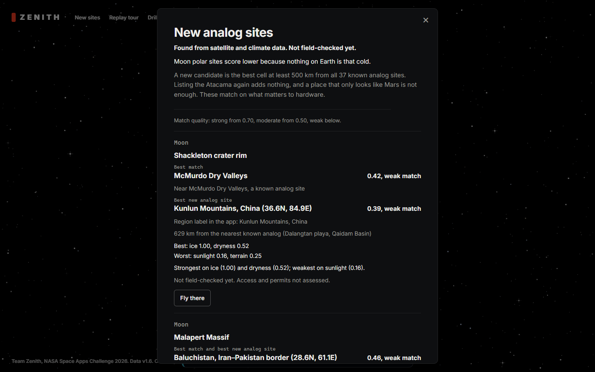

# Zenith: where on Earth to test a Moon or Mars mission

Team Zenith, NASA Space Apps Challenge 2026 (Heilbronn). Challenge: *Identify Earth Locations that Analog the Permanent Moon Base Locations and Mars.*

Zenith scores every patch of bare ground on Earth against seven Moon and Mars base sites, using NASA and other open satellite and climate data, and shows where to test a mission first, including places nobody uses yet.

- **Live app:** https://zenith-analog-sites.vercel.app (opens straight to the new analog sites: https://zenith-analog-sites.vercel.app/#sheet=new-sites)
- **Demo video (30 s):** https://zenith-space-apps.vercel.app/demo.mp4
- **Drill game:** https://zenith-analog-sites.vercel.app/game/index.html

Team: Surya Pratama, Tahir Atmaca, Mohamed Elmallah, Immanuel Hamonangan, Anas Ahmed, Kshitij Savannah.

## We found 7 new analog sites

Found from satellite and climate data. **Not field-checked yet:** the satellites say these places match, and the next step is someone going out to check them. Nobody has visited them for this project. Each one is the best-matching place at least 500 km from all 37 known analog sites on our list, one per target (Malapert's best match is already that far away, so it counts once).

| Site | Target | Score | Distance to nearest known site |
|---|---|---|---|
| Tibesti Mountains, northern Chad (21.4N, 17.4E) | Jezero crater, Mars | 0.73 | 1,836 km (Mount Etna) |
| Southern Libya, north of the Tibesti Mountains (23.1N, 18.6E) | Marius Hills lava-tube pit, Moon | 0.71 | 1,609 km (Balos Cove, Santorini) |
| Southern Taklamakan, Xinjiang, China (37.9N, 84.6E) | Arcadia Planitia, Mars | 0.69 | 618 km (Dalangtan playa, Qaidam Basin) |
| Nubian Desert near Abu Simbel and Lake Nasser, southern Egypt (22.6N, 31.9E) | Meridiani Planum, Mars | 0.68 | 849 km (Wadi Rum) |
| Eastern Yemen, south of the Rub' al Khali (15.4N, 50.9E) | Gale crater, Mars | 0.65 | 1,144 km (Dallol, Danakil Depression) |
| Baluchistan, Iran and Pakistan border (28.6N, 61.1E) | Malapert Massif, Moon | 0.46 | 1,685 km (Tso Kar Valley, Ladakh (ISRO HOPE)) |
| Kunlun Mountains, China (36.6N, 84.9E) | Shackleton crater rim, Moon | 0.39 | 629 km (Dalangtan playa, Qaidam Basin) |



**Does it work?** We never told the engine where agencies test. Of its 175 top sites, 24 landed within 300 km of a known analog site; random bare ground gives about 10 (10.2, Poisson p about 0.00015). Details in [results/validation.md](results/validation.md).

## AI use

Built with AI assistance. The team used Claude (Anthropic) for code, the data and scoring scripts, debugging and writing text. Every score comes from the documented scoring rules in [scoring/DECISIONS_v1_6.md](scoring/DECISIONS_v1_6.md) and the public data listed in [SOURCES.md](SOURCES.md); the team reviewed the results. The new analog sites are model output from satellite and climate data, not field observations.

## Two traps

An analog-site finder can fail in two ways. **Trap one: rediscovering the usual sites.** The Atacama, Iceland and Devon Island are where agencies already test, so listing them again adds nothing. **Trap two: a place that only looks like Mars.** Red rock is not enough; a test site has to match in the ways that matter to hardware: cold, dryness, slopes and rock type. Zenith scores the whole planet on those measurements and, for every target, always shows a second answer: the best place at least 500 km from all 37 known analog sites on our list: a new analog site, not field-checked yet.

## Best match and new analog site per target

Balanced weights (every dimension counts the same). The best match overall comes first, then the best new analog site (not field-checked yet).

| Target | Best match overall | Score | Best new analog site (500+ km from known sites) | Score | Distance to nearest known analog |
|---|---|---|---|---|---|
| Jezero crater, Mars | Pampa del Tamarugal, Atacama, Chile | 0.81 | Tibesti Mountains, northern Chad (21.4N, 17.4E) | 0.73 | 1,836 km (Mount Etna) |
| Meridiani Planum, Mars | Atacama Desert, Chile | 0.76 | Nubian Desert near Abu Simbel and Lake Nasser, southern Egypt (22.6N, 31.9E) | 0.68 | 849 km (Wadi Rum) |
| Gale crater, Mars | Southern Peru coast | 0.73 | Eastern Yemen, south of the Rub' al Khali (15.4N, 50.9E) | 0.65 | 1,144 km (Dallol, Danakil Depression) |
| Marius Hills lava-tube pit, Moon | Harrat lava fields, NW Saudi Arabia | 0.73 | Southern Libya, north of the Tibesti Mountains (23.1N, 18.6E) | 0.71 | 1,609 km (Balos Cove, Santorini) |
| Arcadia Planitia, Mars | Qaidam Basin, China | 0.70 | Southern Taklamakan, Xinjiang, China (37.9N, 84.6E) | 0.69 | 618 km (Dalangtan playa, Qaidam Basin) |
| Malapert Massif, Moon | Baluchistan, Iran and Pakistan border (28.6N, 61.1E) | 0.46 | Same place: the best match is already far from known sites | 0.46 | 1,685 km (Tso Kar Valley, Ladakh) |
| Shackleton crater rim, Moon | McMurdo Dry Valleys, Antarctica | 0.42 | Kunlun Mountains, China (36.6N, 84.9E) | 0.39 | 629 km (Dalangtan playa, Qaidam Basin) |


New analog sites are not field-checked yet, and access and permits are not assessed. Match quality: strong from 0.70, moderate from 0.50, weak below. Every number in this table comes from [`scoring/new_candidates.mjs`](scoring/new_candidates.mjs), which runs the app's own engine and writes [`results/new_candidates.json`](results/new_candidates.json) and [`.md`](results/new_candidates.md); rerun it with `node scoring/new_candidates.mjs`.

## Why a score can differ between the video, the app and this table

Mission weights change the score. For the Jezero best cell (Pampa del Tamarugal), the rover and science mission parts used in the demo weight terrain, dryness and rock more, so it scores 0.86; the Rosalind Franklin mission weights give 0.83; balanced weights give 0.81, the number in the table above. The app shows the same line under any mission score, for example "Mission weights give 0.86 here; balanced weights give 0.81."

## In numbers

- 349,031 land cells on a 0.25° grid (about 25 km); 29,846 cells of bare ground scored against each target.
- 7 targets (3 on the Moon, 4 on Mars), 7 dimensions in every score: cold, dryness, terrain, surface, ice, sunlight and rock type.
- 24 of our 175 top sites sit within 300 km of a known analog site, against 10.2 expected from random bare ground (Poisson p about 0.00015). See [results/validation.md](results/validation.md).
- "Your conditions" reruns the same maths in the browser: it reproduces six of the seven official best scores to within 0.002 (Marius Hills to within 0.003). A full rescore of every cell takes about 0.2 to 0.3 s in Node.

## Limits

A 25 km grid, no soil chemistry, and nobody has visited these sites yet. Nothing on Earth is as cold as any target, so cold is scored on a gentler scale and flagged, and the Moon's polar sites top out near 0.5.

---

The web app is in [`zenith-app/`](zenith-app/) (open `zenith-app/index.html`, no build step). Data sources are listed in [SOURCES.md](SOURCES.md).

This is the team's working repository. The copy submitted to NASA is https://github.com/elmallah111-design/zenith-app (a snapshot of this repo at submission time).

## What Zenith does

1. Scores every 0.25° bare-ground cell on Earth against seven Moon and Mars base sites.
2. Scores seven dimensions: cold, dryness, terrain, surface, ice, sunlight and rock type.
3. Combines them with one fixed scoring method (`scoring/score_v16.py`) and weights.
4. For every target it shows two answers: the best match overall and the best new analog site, 500 km or more from every known analog site (not field-checked yet).
5. It also reports what can only be tested in space: gravity, vacuum or atmosphere, and radiation.

## Folder map

| Folder | What is in it |
|---|---|
| `data/earth/` | Tahir's 11 Earth-layer CSVs and their README (0.25° grid). |
| `data/v1_6/` | Data v1.6 inputs and targets: `earth_features_v1_6.csv.gz` (gzipped, 66 MB unpacked), `precip_merra2_025deg.csv`, `targets.csv`, `known_sites_merged.csv`, `not_matchable.csv`, `targets_v1_6.csv` (every target value with status and source). |
| `scoring/` | `score_v16.py` (the one scoring method) and `SCORING.md` (what each version changed and why). |
| `results/` | Scores per preset, the plan pool, validation, and run summary for data v1.6. |
| `app/` | Mission-plan layer and demo page (`index.html`, `coverage.js`, `data.js`, `data.json`, `build_data.py`, `test.js`). |
| `patches/` | New data layers, one file each. |
| `zenith-app/` | **The web app judges see**: globe, search, results, Simulate, drill game, case studies (`zenith-app/cases/`). |
| `missions/` | Real upcoming Moon and Mars missions and their weights (`missions.json`). |
| `case-studies/`, `docs/` | Placeholders. The written case studies live in `zenith-app/cases/`; slides and the summary were kept on the team Drive. |
| `SOURCES.md` | Every dataset: agency, link, resolution, use, who added it. |

## Open the app

- **Main app:** open `zenith-app/index.html` in a browser. Double-click works, no server or build step, and it runs offline.
- **Mission-plan layer demo:** `app/index.html` (or `app/zenith-plan-demo.html`, the same page in one file).
- **Engine map:** `app/map/map.html` loads binary data with `fetch`, so it needs a local server: run `python3 -m http.server` in `app/map/` and open http://localhost:8000/map.html.

## Rerun scoring

```bash
python3 scoring/score_v16.py <data v1 folder> data/v1_6/precip_merra2_025deg.csv <output folder> patches/
```

The script reads the **data v1 folder layout** (its `targets.csv`, `earth` files and so on). That v1 folder is not in this repo yet, so put it on your own disk first. The second argument is the MERRA-2 precipitation file in `data/v1_6/`.

## Rebuild the app data

See [app/README.md](app/README.md). In short: `python3 build_data.py <data v1 folder> <data v1.1 folder> .` from `app/`.

## Run the tests

```bash
node app/test.js
```

## Version

Current version: **data v1.6**. Every rescoring gets a new version number. Slides quote the version they used.

## Team workflow

- **Never push to `main`.** Work on your own branch, `dev/<github-username>`, open a small pull request, and Kshitij merges it.
- **Stay in your folder.** Tahir works in `patches/` and `data/`. Mo works in `app/` (UI). Immanuel and Surya work in `case-studies/` and `docs/`.
- **One scoring method.** Nobody adds weights or scores outside `scoring/`.
- **Files over 50 MB go on the shared Drive, not git.** Note the Drive link in `SOURCES.md`.

Built with AI assistance (see AI use above). All data sources are listed in [SOURCES.md](SOURCES.md). Code under the [MIT license](LICENSE).
